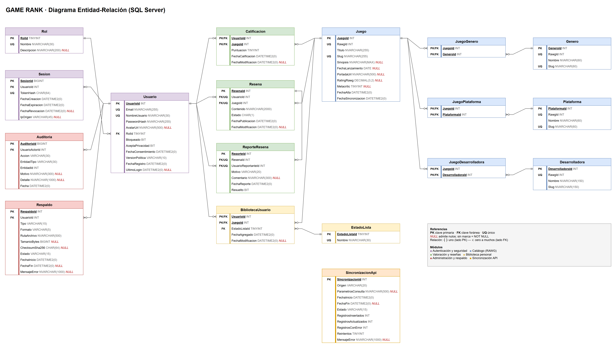

# GAME RANK — Base de datos

Modelo relacional de GAME RANK sobre **Microsoft SQL Server 2019+**.



El diagrama todavía muestra las columnas de RAWG: `Juego.SteamAppId` y `Genero.SteamId` reemplazaron a `RawgId`, Plataforma y Desarrolladora ya no tienen identificador externo y se quitó `Juego.RatingRawg`.

## Scripts

| Script | Contenido |
|---|---|
| `00_run_all.sql` | Ejecuta todo en orden (modo SQLCMD) |
| `01_create_database.sql` | Crea la base `GameRank` (recovery FULL para backups de log) |
| `02_tables.sql` | 18 tablas con PK, FK, UNIQUE, CHECK, DEFAULT e índices |
| `03_views.sql` | `vw_JuegoMetricas`, `vw_FeedResenas`, `vw_ResenasReportadas` |
| `04_procedures.sql` | Procedimientos por módulo (M01–M08), uno o más por caso de uso. Se guarda en UTF-8 con BOM para conservar los acentos de los mensajes |
| `05_seed.sql` | Roles, estados de lista, catálogo de ejemplo con ids reales de Steam, usuarios y actividad de prueba |
| `06_carga_masiva.sql` | Opcional: simulación de volumen (50k juegos, 20k usuarios, ~1M calificaciones, 100k reseñas) |
| `07_actualizar_cuenta.sql` | Migración para bases ya creadas: procedimientos de edición de perfil y cambio de contraseña |
| `08_usuarios_prueba.sql` | Migración para bases ya creadas: contraseña de los usuarios de prueba |

```bash
cd database
sqlcmd -S "(localdb)\MSSQLLocalDB" -b -i 00_run_all.sql
```

Con una instancia local de SQL Server en lugar de LocalDB, usar `-S "."` y agregar `-E`.

En SSMS: abrir `00_run_all.sql` y activar *Query > SQLCMD Mode*. Para la carga masiva, descomentar la última línea o ejecutar `06_carga_masiva.sql` aparte (tarda unos 30 s).

## Tablas por módulo

| Módulo | Tablas |
|---|---|
| M01 Autenticación y Seguridad | `Rol`, `Usuario`, `Sesion` |
| M02/M03 Catálogo e Integración con Steam | `Juego`, `Genero`, `Plataforma`, `Desarrolladora`, `JuegoGenero`, `JuegoPlataforma`, `JuegoDesarrolladora`, `SincronizacionApi` |
| M04 Valoración y Reseñas | `Calificacion`, `Resena`, `ReporteResena` |
| M05 Biblioteca Personal | `EstadoLista`, `BibliotecaUsuario` |
| M07/M08 Administración y Respaldo | `Auditoria`, `Respaldo` |

## Decisiones de diseño

- **Contraseñas**: `Usuario.PasswordHash` guarda el hash que genera el backend (bcrypt/argon2); nunca texto plano. De las sesiones se guarda solo el SHA-256 del token (`Sesion.TokenHash`).
- **Ley 25.326**: `AceptaPrivacidad` (CHECK = 1), `FechaConsentimiento` y `VersionPolitica` dejan constancia del consentimiento. `sp_EliminarUsuario` implementa el derecho de supresión.
- **Unicidad usuario–juego**: `Calificacion` y `BibliotecaUsuario` usan PK compuesta `(UsuarioId, JuegoId)`; `Resena` tiene `UNIQUE (UsuarioId, JuegoId)`. Así se cumplen CU07, CU08 y CU10 sin duplicados.
- **Datos de la API**: `Juego.SteamAppId` y `Genero.SteamId` (UNIQUE) guardan los identificadores de Steam para el upsert de la sincronización (`sp_UpsertJuegoDesdeApi`, que recibe el JSON ya normalizado por el backend). Plataformas y desarrolladoras no tienen identificador en Steam y se identifican por `Slug` (UNIQUE). Los campos opcionales (sinopsis, portada, fecha, Metacritic) admiten NULL.
- **Moderación**: las reseñas se ocultan con `Estado = 'O'` o se eliminan; toda acción administrativa queda en `Auditoria` (sin FK a la entidad afectada, porque puede haber sido eliminada).
- **Cascadas**: borrar un usuario o un juego borra en cascada sus calificaciones, reseñas, listas y sesiones. `ReporteResena.UsuarioReportanteId` no tiene cascada porque SQL Server no admite múltiples rutas de cascada; lo resuelve `sp_EliminarUsuario`.
- **Errores**: los procedimientos lanzan `THROW 50000 + código HTTP` (por ejemplo, 50409 = 409 Conflict, 50403 = 403 Forbidden), así el backend traduce el error directamente a la respuesta HTTP.

## Rendimiento (con `06_carga_masiva.sql`)

Medido a través de la API sobre 50k juegos, 20k usuarios, ~1M calificaciones y 100k reseñas, con SQL Server local y la API en modo Debug, sin contar la primera ejecución de cada consulta:

- Búsqueda con texto, dos géneros, plataforma, puntuación mínima y orden por promedio: **71 ms**.
- Catálogo sin filtros: **521 ms**.
- Consulta más lenta (reseñas recientes de todos los juegos, página 500): **749 ms**, dentro del límite de 2 s del RNF de rendimiento.

## Usuarios de prueba

Todos los usuarios del seed entran con la contraseña `GameRank2026`:

| Correo | Usuario | Rol | Para probar |
|---|---|---|---|
| `superadmin@gamerank.test` | superadmin | Super Administrador | Roles, auditoría, respaldos y restauración, además de la moderación |
| `moderador@gamerank.test` | moderador | Administrador | Moderación de reseñas y bloqueo de cuentas |
| `lucia@gamerank.test` | lucia_rpg | Jugador | Reseñas, calificaciones y biblioteca con datos cargados |
| `tomas@gamerank.test` | tomi_fps | Jugador | Ídem |
| `sofia@gamerank.test` | sofi_indie | Jugador | Ídem |
| `spammer@gamerank.test` | spammer99 | Jugador bloqueado | El login rechaza la cuenta suspendida (403) |

Si la base se creó antes de este cambio, ejecutar `08_usuarios_prueba.sql` para asignarles la contraseña sin volver a crear la base:

```bash
sqlcmd -S "." -E -C -d GameRank -i 08_usuarios_prueba.sql
```

Son cuentas solo para desarrollo y demostración: la contraseña es pública.
